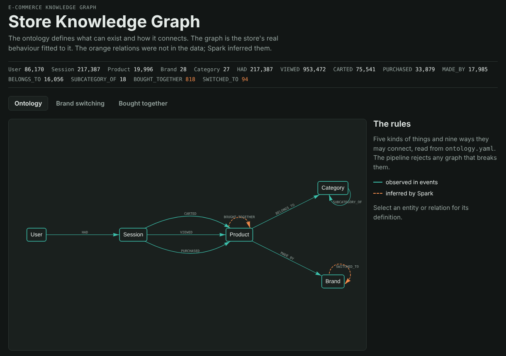
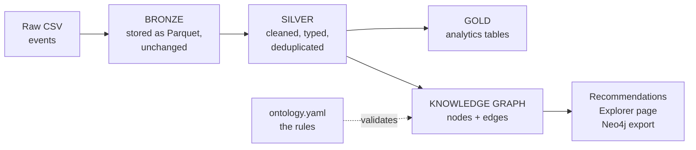
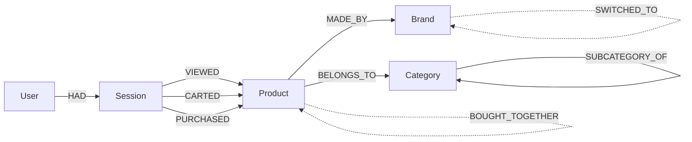
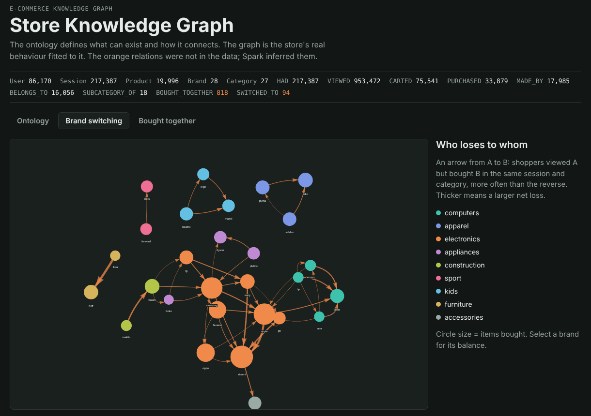

# E-commerce Knowledge Graph on Apache Spark

A PySpark project that turns raw online-store clicks into clean analytics tables and a **knowledge graph** of how customers, products and brands connect.



## What it does

1. **Cleans raw event data** in three layers (Bronze → Silver → Gold) and reports every bad record it removes.
2. **Answers business questions:** conversion funnel, best-converting products, customer segments, daily KPIs.
3. **Builds a knowledge graph** whose structure is defined in an ontology file, and **rejects** any graph that breaks those rules.
4. **Infers new knowledge** that is not in the raw data: products bought together, brands customers switch between, and product importance (PageRank).
5. **Explains its recommendations**, for example: *"10 customers who bought product 1009973 also bought this"*.

Built with **PySpark 4**, tested with **pytest** (9 tests), and runs on a normal laptop in about one minute on the sample data.

---

## The data

Every row is one action a shopper took in an online store:

| Column | Meaning | Example |
|---|---|---|
| `event_time` | When it happened | `2019-10-01 00:02:18 UTC` |
| `event_type` | `view`, `cart` (added to cart) or `purchase` | `view` |
| `product_id` | The product | `1006492` |
| `category_code` | Category path | `kids.toys` |
| `brand` | Brand | `lego` |
| `price` | Price | `60.98` |
| `user_id` | The shopper | `512127531` |
| `user_session` | One visit to the store | `1c1060a9...` |

The format is the one of the public [REES46 e-commerce dataset on Kaggle](https://www.kaggle.com/datasets/mkechinov/ecommerce-behavior-data-from-multi-category-store) (about 42 million events per month).

**The results shown in this README come from synthetic data** made by `src/generate_sample_data.py`: about 1.1 million events in the same format, with realistic behaviour (popular and unpopular products, a view → cart → purchase funnel, evening traffic peaks) and **deliberately broken records** to test the cleaning. Patterns in the synthetic data, such as which brand customers switch to, are random. The same code runs on the real Kaggle data (see [Use the real data](#use-the-real-data)).

---

## How it works



| Layer | What happens | Result on the sample data |
|---|---|---|
| **Bronze** | Raw CSV saved as Parquet with an explicit schema | 1,137,642 events |
| **Silver** | Bad timestamps, invalid event types, bad prices, missing IDs and duplicates removed. A quality report counts each problem | 1,130,471 events kept (7,171 removed, 0.63%) |
| **Gold** | 7 analytics tables (below) | e.g. 21,975 customers segmented |
| **Graph** | 5 node types, 9 relation types, checked against the ontology | 86,170 users, 19,996 products, ~1.3M relations |

### Gold tables

| Table | Question it answers |
|---|---|
| `daily_kpis` | Revenue, visitors, buyers, conversion rate and average order value per day |
| `funnel_by_category` | Where shoppers drop off between view, cart and purchase, per category |
| `product_performance` | How well each product converts, using a smoothed rate that isn't fooled by low traffic |
| `top_products_by_category` | Top 10 products per category |
| `sessions` | Length, depth and outcome of every visit |
| `hourly_heatmap` | When people browse and when they buy (day × hour) |
| `customer_rfm` | Customer segments (Champions, Loyal, At Risk, Hibernating...) from Recency, Frequency and Monetary value |

---

## The knowledge graph

The idea has three steps:

1. **The real world:** shoppers browsing a store.
2. **The ontology** ([`ontology.yaml`](ontology.yaml)): the rules. Which kinds of things exist and how they are allowed to connect.
3. **The knowledge graph:** the actual data, connected according to those rules.



**Solid lines** come straight from the events. **Dotted lines** are inferred by Spark:

| Inferred relation | Meaning | How it is calculated |
|---|---|---|
| `BOUGHT_TOGETHER` | Customers who bought A also bought B | Market-basket analysis: number of shared buyers, confidence = P(B \| A), lift (> 1 means more than chance) |
| `SWITCHED_TO` | Shoppers looked at brand A but bought brand B | Same visit, same category, A viewed but not bought, B bought |
| `pagerank` | How central a product is in the co-purchase network | Weighted PageRank, written with plain Spark DataFrames (1.0 = average) |

**The ontology is enforced.** After the graph is built, every table is checked against `ontology.yaml`: exact columns and types, unique IDs, and no relation pointing to something that doesn't exist. If anything breaks the rules, the pipeline stops. A unit test proves it catches a broken graph.

### Explore it

The pipeline creates an interactive page at `data/graph/explorer.html`. Open it in a browser and click any entity, relation, brand or product to see its details.



### Ask it questions

```bash
python -m src.graph_queries recommend                       # recommendations for a sample user
python -m src.graph_queries recommend --user 512017816      # for a specific user
python -m src.graph_queries switching --category electronics
python -m src.graph_queries product --id 1018612            # what is bought with this product
```

Every recommendation comes with its reason (sample data):

```
product_id  brand   category                     reason
1017518     jbl     electronics.audio.headphone  10 customers who bought 1009973 also bought this
1003963     apple   electronics.smartphone       6 customers who bought 1008105 also bought this
1009304     apple   electronics.smartphone       popular in electronics.smartphone (268 buyers), which you browsed
```

The first two come from the co-purchase graph. The last one is for a shopper who never bought anything, so the graph falls back to popular products in the categories they browsed.

---

## Run it yourself

### 1. Requirements

- **Python** 3.10 to 3.13
- **Java 21** (or 17). On Windows, install **Temurin 21** (`.msi`) from [adoptium.net](https://adoptium.net/temurin/releases/?version=21).

**Windows users:** you don't need to set `JAVA_HOME` or `HADOOP_HOME` by hand. The project finds Java 21 by itself, even if an older Java is installed, and downloads the two Hadoop helper files Spark needs on Windows into `tools\hadoop`.

### 2. Install

```bash
git clone https://github.com/AbdulazizMalfaleh/ecommerce-spark-knowledge-graph.git
cd ecommerce-spark-knowledge-graph

python -m venv .venv
.venv\Scripts\activate            # Windows
# source .venv/bin/activate       # macOS / Linux

pip install -r requirements.txt
```

### 3. Check your machine

```bash
python check_setup.py
```

Every line should say `[ OK ]` and the last line `All good`. If a line says `[FAIL]`, the line under it explains the fix.

### 4. Generate data and run

```bash
python -m src.generate_sample_data     # creates ~1.1M sample events (about 30 seconds)
python run_pipeline.py                 # runs all 4 layers (about 1-2 minutes)
```

Then open `data/graph/explorer.html` in your browser.

While the pipeline runs, you can watch Spark work at http://localhost:4040.

### Useful commands

| Command | What it does |
|---|---|
| `python run_pipeline.py --layers gold graph` | Re-run only some layers |
| `python -m src.graph_viz` | Rebuild only the explorer page |
| `python -m src.export_neo4j` | Export the graph for Neo4j (see below) |
| `pytest -q` | Run the tests |

### Where the results go

```
data/
├── raw/       the input CSV
├── bronze/    Parquet copy of the raw data
├── silver/    clean events (partitioned by date) and products
├── gold/      the 7 analytics tables
└── graph/     nodes/, edges/, explorer.html, neo4j/
```

### Use the real data

1. Create a free account on [kaggle.com](https://www.kaggle.com), go to **Settings → API → Create New Token**, and put the downloaded `kaggle.json` in `C:\Users\<you>\.kaggle\` (Windows) or `~/.kaggle/` (macOS / Linux).
2. Download the data. Start with a sample:

```bash
python -m src.download_data --sample-rows 2000000     # first 2 million rows of October 2019
python -m src.download_data                           # full October 2019 (~42M events, ~5 GB)
```

3. Delete `data/raw/events-sample.csv` so only the real data is read, then run `python run_pipeline.py`.

### Optional: explore in Neo4j

With [Docker Desktop](https://www.docker.com/products/docker-desktop/) running:

```bash
python -m src.export_neo4j
```

This writes CSV files and `data/graph/neo4j/import_command.txt`. From the project folder (Windows `cmd`; in PowerShell or bash use `${PWD}` instead of `%cd%`):

```bash
# 1) import (paste the contents of import_command.txt after "neo4j:5")
docker run --rm -v "%cd%/data/graph/neo4j:/import" -v neo4j_data:/data neo4j:5 <contents of import_command.txt>

# 2) start Neo4j
docker run -d --name kg -p 7474:7474 -p 7687:7687 -v neo4j_data:/data -e NEO4J_AUTH=neo4j/changeme123 neo4j:5
```

Open http://localhost:7474 (user `neo4j`, password `changeme123`) and try the queries in [`neo4j/queries.cypher`](neo4j/queries.cypher).

---

## Engineering notes

Problems found while building this project, and how they were solved.

**1. A unit test caught a crash, and lazy evaluation hid where it came from.**
Spark 4 runs in ANSI mode: a division by zero fails the whole job instead of returning an empty value. A test with a category that had views but no add-to-carts made `purchases / carts` divide by zero. The error did not point at the moment the division was defined. It only fired when the result was collected, because Spark builds a plan and runs nothing until an *action* is called. Every ratio now uses `try_divide`, and timestamps are parsed with `try_to_timestamp`, so bad values become empty instead of crashing the job.

**2. A warning that only matters at scale.**
Customer segments were first scored with `ntile(5)` over a window with no partition. Spark warned: *"Moving all data to a single partition"*. On 22,000 customers that's harmless; on millions it would push all the work onto one CPU core. Replaced with `percentile_approx`, which computes the cut-points in parallel in one pass.

**Other decisions**

- **Explicit schema instead of `inferSchema`.** Guessing column types forces Spark to read the whole file immediately. With a declared schema, reading costs nothing until the data is actually needed.
- **One-pass data-quality report.** All quality rules are counted in a single aggregation, not one count per rule.
- **Smoothed conversion rate:** `(purchases + m·C) / (views + m)`, where `C` is the overall rate. A product with 3 views and 2 sales (67%) no longer beats a product with 5,000 views converting at 8%.
- **Iterative PageRank** uses `localCheckpoint()` each round. Without it, every iteration's plan would include all previous iterations and planning time would grow out of control.
- **Local tuning:** 8 shuffle partitions instead of Spark's default 200, and Adaptive Query Execution enabled.

---

## Project structure

```
├── run_pipeline.py              runs the 4 layers
├── check_setup.py               checks (and on Windows, prepares) your machine
├── ontology.yaml                the ontology: entities, relations, properties
├── requirements.txt
├── src/
│   ├── bronze.py                layer 1: raw → Parquet
│   ├── silver.py                layer 2: cleaning + quality report
│   ├── gold.py                  layer 3: analytics tables
│   ├── graph.py                 layer 4: knowledge graph, inferred relations, PageRank
│   ├── ontology.py              loads ontology.yaml and validates the graph
│   ├── graph_queries.py         recommendations, brand switching, product neighbours
│   ├── graph_viz.py             builds the explorer page
│   ├── export_neo4j.py          Neo4j import files
│   ├── generate_sample_data.py  synthetic data
│   ├── download_data.py         real data from Kaggle
│   ├── spark_session.py         Spark settings
│   ├── win_env.py               Windows: finds Java, gets Hadoop helper files
│   ├── config.py                paths and parameters
│   └── templates/               explorer page template
├── neo4j/queries.cypher         example questions for Neo4j
├── tests/                       9 tests (pipeline + graph)
└── docs/images/                 screenshots
```

## Roadmap

| Phase | Content | Status |
|---|---|---|
| 1 | Bronze / Silver / Gold pipeline, quality report, tests | ✅ Done |
| 2 | Ontology and knowledge graph, inferred relations, explainable recommendations, explorer | ✅ Done |
| 3 | Performance experiments with numbers: CSV vs Parquet, partition pruning, caching, query plans (`explain()`) | ⏳ Next |
| 4 | Machine-learning recommendations (MLlib ALS) compared with the graph recommendations | ⏳ |
| 5 | Dashboard (Streamlit) and Docker | ⏳ |

## Author

[@AbdulazizMalfaleh](https://github.com/AbdulazizMalfaleh)
